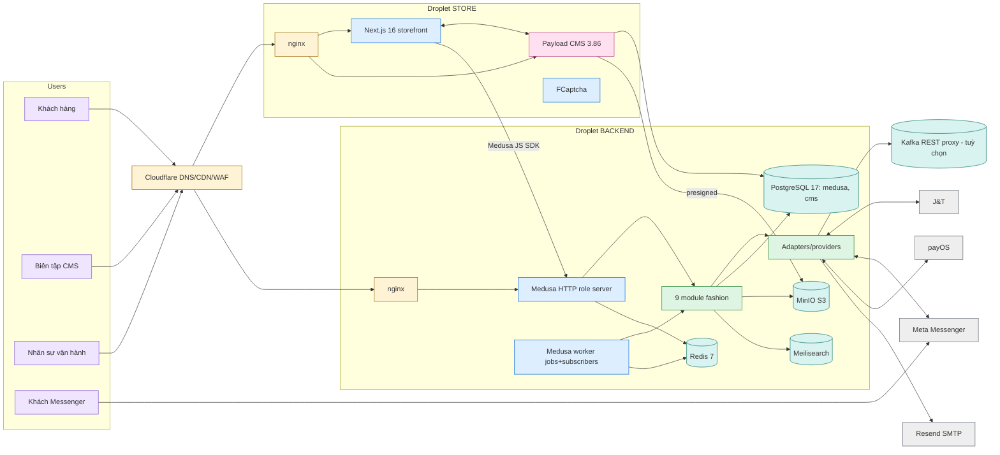
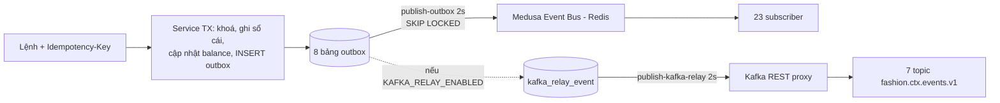
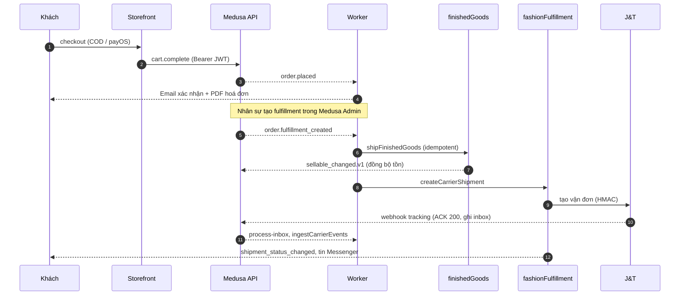

# FECS Platform – Technical Design Document v2.0 (as-built)

|                        |                                                                                                                                          |
| ---------------------- | ---------------------------------------------------------------------------------------------------------------------------------------- |
| **Trạng thái**         | Mô tả hệ thống **như đã được xây dựng**, dựng lại từ source code                                                                         |
| **Ngày review**        | 2026-11-09                                                                                                                               |
| **Commit**             | `5138517` (nhánh làm việc hiện tại)                                                                                                      |
| **Thay thế / bổ sung** | Bổ sung cho `Fashion_Platform_Technical_Design_Document_v1.0.md` (baseline đề xuất). v1.0 giữ nguyên làm tài liệu mục tiêu.              |
| **Diagram tương tác**  | [`docs/architecture/architecture-live.html`](docs/architecture/architecture-live.html) – mở trực tiếp bằng trình duyệt, không cần server |

---

## 0. Cách đọc tài liệu này

### 0.1 Phương pháp và độ tin cậy

Tài liệu được viết sau khi đọc trực tiếp `medusa-config.ts`, `payload.config.ts`, `next.config.mjs`, `proxy.ts`, `middlewares.ts`, thư viện outbox/inbox/idempotency, mọi job, các workflow/step chính, state machine, model của từng module, manifest K8s, các file compose, CI, nginx và tài liệu vận hành. Phần còn lại (thân của các service method lớn, mọi component storefront, thân của `deploy.sh`) chỉ được lướt qua cấu trúc.

Quy ước:

- Mọi con số (số route, job, subscriber, dòng code) được đếm lại từ repo ở commit trên.
- Đường dẫn dạng `file:dòng` có thể kiểm tra lại.
- Mục nào ghi **(suy ra)** là kết luận từ tên gọi hoặc cấu trúc, chưa đọc trọn code.
- Tài liệu **không chạy** hệ thống, không chạy test hay e2e. Kết quả "kịch bản X kiểm tra Y" nghĩa là script có assertion đó, không phải là đã chạy qua.

### 0.2 Phạm vi

Gồm toàn bộ monorepo: `apps/medusa`, `apps/store`, `packages/*`, `infra/*`, `docker/*`, `e2e/*`, `.github/*`, `docs/*`. Không gồm hạ tầng thật bên ngoài repo (tài khoản DigitalOcean, Cloudflare, Meta, J&T, payOS).

---

## 1. Tóm tắt điều hành

FECS Platform là một monorepo pnpm/turbo gồm hai ứng dụng:

1. **`apps/medusa`** – Medusa 2.18.0, chạy theo kiểu _modular monolith_. Ngoài commerce lõi, nó chứa **9 module nghiệp vụ thời trang** (≈15k dòng) bao phủ mua nguyên liệu, tồn kho vải theo lô/cuộn, BOM/MRP/lệnh sản xuất, QC, thành phẩm (FG), vận đơn J&T, bán hàng qua Messenger và đổi/trả. Một image chạy ba vai trò (`server`, `worker`, `shared`).
2. **`apps/store`** – Next.js 16 (canary) storefront có nhúng **Payload CMS 3.86** (admin tại `/admin`). Hỗ trợ tiếng Việt là ngôn ngữ mặc định.

Giao tiếp giữa các phần: storefront gọi Medusa qua JS SDK; Medusa phát sự kiện miền bằng **transactional outbox**, nhận webhook bằng **durable inbox**, mọi lệnh ERP đều idempotent. Kafka là tuỳ chọn và chỉ đi qua REST proxy.

**Điểm mạnh nổi bật** (có bằng chứng trong code):

- Tính đúng đắn của tồn kho được thiết kế kỹ: sổ cái bất biến, khoá theo thứ tự, advisory lock, kiểm lại sau khi khoá, job đối soát, invariant được đưa lên thành alert.
- Tích hợp ngoài chịu lỗi tốt: tạo vận đơn theo kiểu claim → gọi → ghi kết quả, trạng thái UNKNOWN được đối chiếu thay vì tạo trùng; tracking lọc theo thứ hạng; webhook ACK nhanh rồi xử lý bất đồng bộ.
- Vận hành được tính đến: 23 alert có runbook, feature flag mặc định tắt, CI có kiểm migration, tương thích sự kiện, quét bảo mật, và một stack e2e có kịch bản chaos.

**Rủi ro chính** (chi tiết ở §15):

| Mức    | Phát hiện                                                                                                                                                                                                                                |
| ------ | ---------------------------------------------------------------------------------------------------------------------------------------------------------------------------------------------------------------------------------------- |
| High   | **R-01** Payload `products` cho tạo/xoá chỉ cần query `?is_from_medusa` (không xác thực). **Đã sửa trong code** sau review (xem §15), chưa triển khai.                                                                                   |
| High   | **R-13** Production trên droplet không có PITR, MinIO không được backup; tài liệu vận hành lại nói "Postgres PITR".                                                                                                                      |
| Medium | Một droplet backend là điểm lỗi duy nhất; chạy `shared` mode nên mất cách ly webhook. CI không phủ storefront. Phụ thuộc không tái lập (Next canary, Medusa store packages `latest`). Storefront thiếu UI đổi trả/tracking dù API đã có. |

Khoảng cách lớn nhất so với TDD v1.0 là **hạ tầng**: v1.0 giả định Kubernetes + Kafka + ClickHouse + Temporal + bộ Grafana/Loki; thực tế production là Docker Compose trên 2 droplet, Kafka chỉ là relay REST tuỳ chọn, analytics là 14 SQL view, không có Temporal. Xem §2.

---

## 2. Đối chiếu với TDD v1.0

| Hạng mục               | v1.0 (mục tiêu)                                                                                                                          | As-built                                                                                                                                                                                                                                                                                                                            |
| ---------------------- | ---------------------------------------------------------------------------------------------------------------------------------------- | ----------------------------------------------------------------------------------------------------------------------------------------------------------------------------------------------------------------------------------------------------------------------------------------------------------------------------------- |
| Cấu trúc repo (§6)     | `apps/{storefront,medusa,backoffice,webhook-gateway,workers}`, `domains/`, `integrations/`, `packages/{contracts,event-schemas,authz,…}` | `apps/{store,medusa}`; miền nằm trong `apps/medusa/src/modules`; `integrations/` là `apps/medusa/src/integrations`; backoffice là **Medusa Admin extension** (`apps/medusa/src/admin`); webhook gateway là route `/webhooks/*` trong Medusa; workers là role `worker`. `packages/` chỉ có `config`, `env`, `ui`, `email`, `medusa`. |
| Deployment (§5)        | Kubernetes, 7 loại worker riêng, ingress nhiều service                                                                                   | Production: **2 droplet DigitalOcean + Docker Compose + nginx host**. K8s (Kustomize) chỉ có cho Medusa với 3 role (`server`, `webhook`, `worker`) và là manifest tham chiếu (placeholder).                                                                                                                                         |
| Event bus (§36–38)     | Kafka, một topic mỗi bounded context                                                                                                     | Outbox → Medusa event bus (Redis); Kafka **tuỳ chọn** qua **REST proxy**; 7 topic đang dùng, returns đi chung topic `fulfillment`, social đi chung `notification`, topic `commerce` được định nghĩa nhưng chưa dùng.                                                                                                                |
| Analytics (§51)        | PostgreSQL → CDC → Kafka → ClickHouse → dbt → BI                                                                                         | **14 SQL view** trong schema `analytics` của Postgres, tạo khi khởi động, phục vụ qua `/admin/analytics-marts`. Không có ClickHouse/dbt/CDC.                                                                                                                                                                                        |
| Orchestration (§52)    | Temporal cho MTO/return                                                                                                                  | **Không có Temporal.** Dùng Medusa workflow engine (Redis) + job polling + state machine.                                                                                                                                                                                                                                           |
| Observability (§48–50) | OTel, Prometheus, Grafana, Loki                                                                                                          | OTel + Sentry trong code Medusa; Prometheus chỉ có `PrometheusRule` + `ServiceMonitor`. **Không có** collector, Grafana, Loki, Alertmanager. Storefront không đo.                                                                                                                                                                   |
| Redis (§53)            | cache, lock, rate limit, session                                                                                                         | Còn là event bus, workflow engine và session store của Medusa. Rate limit đăng nhập ở storefront dùng Redis; nginx giới hạn theo IP.                                                                                                                                                                                                |
| Secrets (§42)          | secret manager                                                                                                                           | K8s: ví dụ ExternalSecret (AWS SM). Droplet: file `.env` sinh bởi `deploy.sh`.                                                                                                                                                                                                                                                      |
| Search                 | không nhắc                                                                                                                               | **Meilisearch** v1.56.1.                                                                                                                                                                                                                                                                                                            |
| Thanh toán             | không nhắc                                                                                                                               | **payOS** (VietQR) + COD; code Stripe ở UI nhưng không có provider backend.                                                                                                                                                                                                                                                         |
| CMS                    | "Content"                                                                                                                                | **Payload CMS** nhúng trong storefront.                                                                                                                                                                                                                                                                                             |
| ADR-001…008            | –                                                                                                                                        | Về cơ bản được hiện thực (xem §14).                                                                                                                                                                                                                                                                                                 |

Kết luận: v1.0 vẫn đúng ở tầng **miền** (bounded context, ledger, outbox/inbox, provider abstraction) và sai lệch chủ yếu ở tầng **nền tảng triển khai**.

---

## 3. Kiến trúc tổng thể

### 3.1 Sơ đồ container



Sơ đồ đầy đủ, có rủi ro gắn theo node, nằm ở file HTML.

### 3.2 Nguyên tắc kiến trúc đang được áp dụng

1. **Medusa sở hữu thương mại** (catalogue, giá, giỏ, đơn, thanh toán, tồn thương mại).
2. **Tồn nguyên liệu tách khỏi tồn thương mại** (BR-002). Reconcile job phát hiện rò rỉ (`raw_material_leaks`) và alert `RawMaterialLeakedIntoCommerce`.
3. **FG là cầu nối**: tồn Medusa là hình chiếu có version của FG.
4. **Sổ cái bất biến + số dư là hình chiếu** cho cả vật tư và FG.
5. **Outbox/inbox/idempotency** cho mọi giao tiếp ra/vào.
6. **Nhà cung cấp ngoài đứng sau adapter** (`src/integrations`), không lọt vào mô hình miền.
7. **Cờ tính năng mặc định tắt**, bật từng tích hợp độc lập.
8. **Agent chỉ dùng công cụ có kiểu**, chỉ đọc, PII được che.

---

## 4. Công nghệ và phiên bản

| Lớp            | Công nghệ                                                                       | Phiên bản / ghi chú                                                                                               |
| -------------- | ------------------------------------------------------------------------------- | ----------------------------------------------------------------------------------------------------------------- |
| Quản lý repo   | pnpm workspace + turbo                                                          | `pnpm@11.9.0`, `turbo ^2.10.3`; catalog phiên bản dùng chung; `minimumReleaseAge: 60`                             |
| Backend        | Medusa                                                                          | **2.18.0** (ghim đồng bộ mọi `@medusajs/*` trong `apps/medusa`), MikroORM 6.6.14, Node 22 (image)                 |
| Storefront     | Next.js                                                                         | **16.3.0-canary.95** (ghim canary), React 19.2, `cacheComponents: true`, `next-intl` 4                            |
| CMS            | Payload                                                                         | 3.86; adapter Postgres, Lexical, S3 storage, nodemailer, các plugin redirects/nested-docs/seo/form-builder/search |
| Database       | PostgreSQL                                                                      | 17 (compose prod/e2e); hai database: Medusa và CMS                                                                |
| Cache/bus      | Redis                                                                           | 7, AOF                                                                                                            |
| Object storage | MinIO (S3)                                                                      | build từ commit ghim; media public-read chỉ `cms/media/*`                                                         |
| Search         | Meilisearch                                                                     | 1.56.1                                                                                                            |
| Ảnh            | imgproxy                                                                        | 4.0.17, presets-only (tuỳ chọn)                                                                                   |
| Captcha        | FCaptcha                                                                        | 1.46.1                                                                                                            |
| Email          | Resend qua SMTP, `react-email`                                                  | `packages/email`, vi mặc định                                                                                     |
| PDF hoá đơn    | pdfmake                                                                         | module `invoice-generator`                                                                                        |
| Thanh toán     | payOS (VND), COD                                                                | `pp_payos_payos`, `pp_system_default`                                                                             |
| Quan sát       | OpenTelemetry (OTLP gRPC), Sentry, Prometheus                                   | xem §12                                                                                                           |
| Lint/format    | Ultracite 7.8.4 (oxlint + oxfmt), lefthook                                      | CI để lint ở chế độ không chặn                                                                                    |
| Test           | script integration tuỳ biến (Postgres), HTTP/perf, Playwright, stack e2e Docker | xem §13                                                                                                           |

---

## 5. Cấu trúc monorepo

```text
apps/
  medusa/      Medusa 2.18, src/{modules,workflows,api,jobs,subscribers,lib,integrations,admin,links,scripts}
               ≈ 138 route.ts · 28 workflow file (103 createWorkflow) · 25 step file · 11 job · 23 subscriber
               integration-tests/ (01…16, http/, perf/, e2e/)
  store/       Next.js 16 + Payload 3.86  (24 page.tsx)
packages/
  config/      tsconfig.base.json (chỉ TS config; README nói có lint config là sai)
  env/         Zod env (t3-env) – KHÔNG có nơi nào import
  ui/          shadcn/base-ui + Tailwind v4 (≈25 file store dùng)
  email/       Template react-email (vi/en), compile CJS khi build image Medusa
  medusa/      SDK admin tối giản để Payload gọi Medusa (types any)
infra/
  docker/      medusa.Dockerfile, store.Dockerfile
  k8s/         Kustomize: base + overlays staging/production + migrate Job + examples
  deploy/      Compose cho 2 droplet + nginx templates + deploy.conf.example
  nginx/       Cấu hình tham chiếu một server (bibaestudios.com) + test.sh
  observability/  PrometheusRule (23 alert) + ServiceMonitor
docker/        compose dev / platform / e2e + mock providers + chaos
e2e/storefront Playwright (độc lập khỏi workspace)
docs/          backoffice, operations, deploy-*, local-demo, runbooks, events/catalog.json
scripts/       deploy.sh (1.057 dòng)
```

Ghi chú: `apps/medusa/src/modules` có 14 thư mục (9 module nghiệp vụ fashion + `payload`, `meilisearch`, `smtp`, `payos`, `invoice-generator`) và một README.

---

## 6. Backend Medusa

### 6.1 Cấu hình (`apps/medusa/medusa-config.ts`)

Ba profile:

- **Bình thường**: product, auth (chỉ `emailpass`), `workflow-engine-redis` (đăng ký vô điều kiện), file (S3/MinIO; `file-local` khi `LOCAL_STACK`), analytics (PostHog nếu có key, ngược lại local), notification (provider tuỳ biến `smtp`; `notification-local` ở LOCAL_STACK khi không có mật khẩu SMTP), `payload`, `meilisearch`, `invoice-generator`, payOS (chỉ khi đủ biến môi trường), và Redis infra (event-bus, cache, locking) **chỉ khi có `REDIS_URL`**. Plugin duy nhất: `@medusajs/draft-order`.
- **`INTEGRATION_TEST=true`**: workflow engine in-memory, admin tắt, không Redis/Meili/S3/email.
- **`LOCAL_STACK=true`**: topology production với các thế thân cục bộ (xem §11.3).

Các thiết lập đáng chú ý:

- `MEDUSA_WORKER_MODE`: `server | worker | shared`; `admin.disable` khi `worker`.
- Pool DB: `DB_POOL_MIN` (2) / `DB_POOL_MAX` (10) / `DB_POOL_IDLE_MS`; `DB_SSL`, `DB_SSL_REJECT_UNAUTHORIZED`.
- Khi có Redis, session được lưu ở Redis để mọi replica phục vụ được mọi request admin.
- Nhiều biến môi trường bị bắt buộc ở production: loader `validate-secrets` (`assertProductionSecrets`) từ chối khởi động nếu thiếu hoặc dùng secret mặc định.

### 6.2 Chín module nghiệp vụ

| Module (key)         | Bảng chính                                                                                                                                                                                                                                                                                                             | Trách nhiệm                                                                                                                                   |   LOC |
| -------------------- | ---------------------------------------------------------------------------------------------------------------------------------------------------------------------------------------------------------------------------------------------------------------------------------------------------------------------- | --------------------------------------------------------------------------------------------------------------------------------------------- | ----: |
| `integration`        | `audit_log`, `platform_setting`, `country_profile`, `ops_gauge`, `inbox_event`, `kafka_relay_event`                                                                                                                                                                                                                    | Audit, cấu hình theo scope (GLOBAL/COUNTRY/WAREHOUSE), hồ sơ quốc gia, inbox webhook, queue relay Kafka, loader tạo 14 mart + kiểm tra secret |   805 |
| `materialInventory`  | `material`, `material_location`, `material_lot`, `material_roll`, `material_balance`, `material_stock_movement`, `material_reservation(+line)`, `material_transfer`, `material_cycle_count`                                                                                                                            | Tồn nguyên liệu theo lot/dye lot/cuộn; nhận, giữ chỗ, xuất, trả, huỷ, điều chỉnh, kiểm kê (maker-checker), chuyển kho, QC hold                | 3.531 |
| `procurement`        | `supplier`, `purchase_order(+line)`, `goods_receipt(+line)`                                                                                                                                                                                                                                                            | PO và phiếu nhập hai pha                                                                                                                      | 1.128 |
| `manufacturing`      | `bom(+line)`, `routing(+operation)`, `work_center`, `manufacturing_order`, `mo_material_requirement`, `production_batch`, `cut_plan`, `bundle`, `operation_execution`, `packing_record`, `manufacturing_exception`, `production_request`, `material_planning_param`, `sku_planning_param`, `mrp_run`, `mrp_suggestion` | BOM/Routing có version, MRP, MO (13 trạng thái), cắt, bundle, thao tác, đóng gói, hàng đợi MTO                                                | 3.973 |
| `quality`            | `quality_inspection`                                                                                                                                                                                                                                                                                                   | Ghi kết quả kiểm                                                                                                                              |   293 |
| `finishedGoods`      | `fg_location`, `fg_batch`, `fg_balance`, `fg_movement`, `fg_allocation`, `fg_shipment_line`, `fg_transfer`, `commerce_sync_state`                                                                                                                                                                                      | Tồn thành phẩm, giữ chỗ cho đơn, xuất, chuyển, truy vết lô, hình chiếu sang Medusa                                                            | 1.824 |
| `fashionFulfillment` | `carrier_shipment`, `tracking_event`, `shipment_exception`                                                                                                                                                                                                                                                             | Vận đơn carrier (J&T), tracking, ngoại lệ giao hàng                                                                                           | 1.373 |
| `socialCommerce`     | `customer_channel_identity`, `channel_link_code`, `conversation_message`, `notification_log`                                                                                                                                                                                                                           | Định danh Messenger, consent, handoff, thông báo                                                                                              | 1.279 |
| `returns`            | `return_authorization`, `rma_item`                                                                                                                                                                                                                                                                                     | Đổi/trả, kiểm hàng, hoàn tiền, hàng thay                                                                                                      |   949 |

Các module hạ tầng/nhà cung cấp: `payload` (HTTP client tới Payload), `meilisearch`, `smtp` (provider notification), `payos` (provider payment), `invoice-generator` (`invoice`, `invoice_config`).

Đặc điểm chung:

- Mỗi module nghiệp vụ có **bảng outbox và idempotency riêng** (8 bảng outbox, xem §7).
- Service là class lớn viết tay; SQL thô (`FOR UPDATE`, advisory lock) qua `safeTable` trong `lib/sql.ts`.
- Migration viết/generate theo từng module (`src/modules/<m>/migrations`); CI kiểm tra không có chênh lệch với `medusa db:generate`.
- **Chỉ một `defineLink`**: `product ↔ payload_product` (read-only). Mọi tham chiếu khác (`order_id`, `customer_id`, `sku`…) là cột text (R-16).

### 6.3 Tồn kho nguyên liệu: mô hình và đồng thời

- **Khoá cân bằng**: `balance_key = material|lot|roll|location`; mỗi dòng có `on_hand`, `reserved`, `qc_hold`, `damaged`, `version`. `available = on_hand − reserved − qc_hold − damaged`. Invariant `reserved + qc_hold + damaged ≤ on_hand` được kiểm tra bởi reconcile và alert `StockInvariantViolated`.
- **Mọi thay đổi vật lý** ghi một dòng `material_stock_movement` (bất biến, append-only bằng trigger). Giữ chỗ không phải movement vật lý.
- **Giữ chỗ** (`reserveMaterial`, `materialInventory/service.ts:379-520`):
  1. `idempotent(...)` theo key.
  2. `pg_advisory_xact_lock(hashtext('mres:<materialId>'))` – mỗi lần một lệnh giữ chỗ trên một vật tư.
  3. Khoá toàn bộ ứng viên theo thứ tự id (`FOR UPDATE ... ORDER BY id`).
  4. Vòng lặp tối đa `MAX_RESERVE_ATTEMPTS`: tính kế hoạch phân bổ (`lib/allocation.ts`), khoá các dòng được chọn, **kiểm lại** `available ≥ qty`.
  5. Không thoả → lỗi `RESERVATION_CONTENTION` (cho phép thử lại).
  6. Ghi `material_reservation` + `lines`, cập nhật `reserved`, enqueue outbox `inventory.material_reserved.v1`.
- **Chính sách vải**: `SAME_DYE_LOT_FIFO` mặc định; số dye lot tối đa theo vật tư (`max_dye_lots`); vượt thì cần `planner_approved` (quyền `manufacturing:approve`) và được audit.
- Tạo/lấy dòng balance dùng advisory lock theo `balance_key` để tránh trùng.
- Transaction-scoped locks nên tương thích PgBouncer chế độ transaction (ghi trong `docs/operations.md`).

### 6.4 Manufacturing

- **BOM/Routing** có version `DRAFT → RELEASED`; MO ghim `bom_version` và `routing_version`.
- **MRP** (`lib/mrp.ts`): nhu cầu gộp − tồn khả dụng − hàng về đã xác nhận (từ `procurement.confirmedIncoming`) + đệm an toàn → `net_requirement` → `mrp_suggestion` (PENDING/APPROVED/REJECTED). Planner duyệt thì tạo MO.
- **MO state machine** (`lib/mo-state.ts`): 13 trạng thái (DRAFT, PLANNED, MATERIAL_CHECK, MATERIAL_RESERVED, RELEASED, IN_PROGRESS, QC_PENDING, PACKING, PARTIALLY_COMPLETED, ON_HOLD, COMPLETED, CANCELLED, FAILED). ON_HOLD nhớ `held_from_status`.
- **Luồng sản xuất**: kiểm vật tư → giữ chỗ (saga) → release → xuất vật tư → cut plan → cắt (tạo bundle) → thực hiện thao tác theo routing (có QC gate) → `inspect-bundle` → rework/pack → nhận FG.
- **Overproduction và vượt dye lot** cần `manufacturing:approve` và sinh audit.
- **MTO**: `production_request` (unique theo dòng đơn). Job `process-production-requests` (30 giây) kiểm cổng thanh toán (`MTO_PAYMENT_GATE`: `captured | authorized | none`), tạo MO, giữ chỗ, release. Thiếu vải → `WAITING_MATERIAL`, thử lại; alert nếu chờ > 4 giờ.

### 6.5 Fulfillment (J&T)

- `carrier_shipment.create_state ∈ {PENDING, SUCCEEDED, FAILED_RETRYABLE, FAILED_FINAL, UNKNOWN}` tách khỏi `status` canonical.
- **Tạo vận đơn** (`createCarrierShipment`): claim bản ghi → gọi carrier → ghi kết quả. Lỗi carrier trả về như **trạng thái**, không ném, nên đơn/fulfillment không bị rollback vì carrier sập. `UNKNOWN` được đối chiếu (`confirmAbsentAtCarrier`) để không tạo trùng; job `retry-carrier-shipments` (1 phút) thử lại.
- **Trạng thái canonical** (12): CREATED, PICKUP_PENDING, PICKED_UP, IN_TRANSIT, ARRIVED_HUB, OUT_FOR_DELIVERY, DELIVERED, DELIVERY_FAILED, RETURNING, RETURNED, CANCELLED, EXCEPTION. `decideTransition` chỉ cho tiến theo thứ hạng (từ chối DUPLICATE, REGRESSION, TERMINAL, NOT_ALLOWED), nên sự kiện đến muộn không kéo lùi trạng thái; vẫn được lưu `tracking_event` (outcome APPLIED/IGNORED).
- **Bù webhook thiếu**: job `poll-carrier-tracking` (1 phút; coi là cũ sau `TRACKING_POLL_STALE_SECONDS`, mặc định 15 phút).
- **Ngoại lệ giao** mở `shipment_exception` cho hàng đợi hỗ trợ; có thể `replace` vận đơn (cũ giữ làm lịch sử).
- Bảng ánh xạ trạng thái `JT_STATUS_MAP_JSON`: tài liệu vận hành yêu cầu đối chiếu với hợp đồng J&T thật trước go-live; hợp đồng đó **chưa được xác minh** trong repo.

### 6.6 Social commerce và agent

- Webhook Meta ghi inbox (message_id duy nhất) → `handle-inbound` → định danh, consent, handoff BOT/người → luật ý định (`intent.ts`) → trả lời qua Graph API.
- **LLM chỉ là dự phòng** khi luật không nhận ra ý định (`AGENT_LLM_ENABLED`): chọn đúng một công cụ **đọc** (trạng thái đơn, tracking, tiến độ sản xuất, chính sách đổi trả), đầu ra kiểm schema chặt, PII được che trước khi gửi. Checkout, link, stop, mute **không bao giờ** do mô hình chọn.
- Thông báo ra: `notify-customer-events` (NOTIFYING_EVENTS), `dedupe_key`, trần số tin/giờ (`social.notifications_per_hour`); tin hoãn được `flush-deferred-notifications` (5 phút) gửi lại.
- Link checkout: `/store/fashion/social/checkout-link` + route storefront `/checkout/social?token=` (yêu cầu đăng nhập).

### 6.7 Returns

`return_authorization.status ∈ {REQUESTED, AUTHORIZED, REJECTED, IN_TRANSIT, RECEIVED, INSPECTED, CLOSED, CANCELLED}`. Điều kiện trả trong `RETURN_WINDOW_DAYS` (mặc định 14) hoặc `country_profile.return_window_days`; ngoại lệ cần `override_reason` + audit. Item được kiểm với `disposition ∈ {PENDING, A_GRADE, B_GRADE, REWORK, DAMAGED, SCRAP}` và vị trí đích; `stock_posted` đánh dấu đã ghi kho. Hoàn tiền bị chặn trần (`refund-cap.ts`); trạng thái hoàn tiền `NONE | REQUESTED | COMPLETED | FAILED`. Đổi hàng giữ chỗ FG cho hàng thay rồi giao `ship-replacement`.

### 6.8 API và phân quyền

**Nhóm route** (138 `route.ts`):

- `/admin/*`: ERP (material-inventory, procurement, manufacturing, finished-goods, fulfillment, returns, quality, social, analytics-marts, country-profiles, settings, ops/summary, access) cùng các route kế thừa từ starter (`meilisearch/sync`, `payload/sync`, `invoice-config`, `orders/:id/invoices`, `custom`).
- `/store/*`: sản phẩm/tìm kiếm/lọc, hoá đơn, và `/store/fashion/{returns, orders/:id/{shipments,production-status}, social/{link-code,checkout-link}}` (xác thực `customer`).
- `/webhooks/{jt/tracking, meta, payos}`; `/internal/{metrics, ready}`; `/auth/*` (Medusa).

**Lớp bảo vệ**:

1. `authenticate("user", ["session","bearer"])` cho route admin ERP; `authenticate("customer", ...)` cho `/store/fashion/*`.
2. `requirePermission(<domain:action>)` theo từng route; `requirePermissionIf` cho quyền điều kiện (ví dụ `planner_approved`).
3. `coreAdminGuard` trên `/admin/*`: route lõi của Medusa (đơn, sản phẩm, khách…) cũng cần vai trò fashion; API key bí mật không có vai trò nên bị từ chối ở route cần quyền.
4. `protectRoleMetadata` chặn ghi khoá vai trò qua `/admin/users` và `/admin/invites` nếu không có `roles:manage`.
5. Webhook không xác thực kiểu người dùng; chữ ký là kiểm soát truy cập (HMAC J&T, `X-Hub-Signature-256` Meta, chữ ký SDK payOS).
6. `/internal/metrics` cần bearer `METRICS_TOKEN`; nginx chặn `/internal/` ra ngoài.

**Vai trò** (15, lưu trong `user.metadata.fashion_roles`): ERP_ADMIN, PROCUREMENT, WAREHOUSE_OPERATOR, WAREHOUSE_MANAGER, PRODUCTION_PLANNER, CUTTING_OPERATOR, SEWING_OPERATOR, SEWING_SUPERVISOR, QC, PACKING_OPERATOR, COMMERCE_ADMIN, CUSTOMER_SUPPORT, FINANCE, SRE, AUDITOR. Quyền dạng `domain:action` trong `lib/authz/permissions.ts`.

**Quy ước lệnh**: `commandRoute(workflow)` bắt buộc header `Idempotency-Key` (≤ 200 ký tự), có actor và correlation id; `listHandler`/`retrieveHandler` đọc qua `query.graph` với allow-list bộ lọc và `MAX_PAGE_SIZE` 200.

**Lỗi**: error handler tuỳ biến gắn `correlation_id` (header `x-correlation-id` + body), gửi Sentry với lỗi non-4xx, dịch thông báo sang tiếng Việt theo `x-locale`/`Accept-Language`.

### 6.9 Workflow

28 file workflow (103 `createWorkflow`), 25 file step. Hầu hết step tạo bằng `wrapStep` **không có compensation**. Các step có bù trừ: `reserveMaterialStep`, `reserveMoMaterialsStep`, `issueToMoStep`, `postGoodsReceiptStep` (void), `uploadProductMediaStep`. Với phần còn lại, tính nhất quán dựa vào idempotency key, state machine và job reconcile/settle (R-11).

Một số workflow tiêu biểu: `procurement-receive-goods`, `reserve-mo-materials`, `inspect-bundle`, `pack-and-receive-finished-goods`, `sync-sellable-to-medusa`, `on-fulfillment-created`, `ingest-carrier-events`, `returns-*`, và các workflow Payload/Meilisearch/invoice/analytics kế thừa từ starter.

### 6.10 Subscriber và job

**23 file subscriber**, trong đó nhóm nghiệp vụ:

| Sự kiện                              | Subscriber                                                                        | Việc làm                                                                                                                                      |
| ------------------------------------ | --------------------------------------------------------------------------------- | --------------------------------------------------------------------------------------------------------------------------------------------- |
| `order.placed`                       | `order-placed`, `mto-order-placed`, `notify-order-confirmed`                      | analytics + hoá đơn PDF + email; tạo `production_request` (MTO); Messenger                                                                    |
| `order.fulfillment_created`          | `order-fulfillment-created`                                                       | `onFulfillmentCreatedWorkflow`: xuất FG (cờ `MANUFACTURING_ENABLED`) và tạo vận đơn (cờ `JT_FULFILLMENT_ENABLED` + `JT_AUTO_CREATE_SHIPMENT`) |
| `finished-goods.sellable_changed.v1` | `fg-sellable-changed`                                                             | đồng bộ tồn sang Medusa                                                                                                                       |
| `fulfillment.shipment_created.v1`    | `attach-tracking-label`, `attach-return-shipment`                                 | gắn tracking lên fulfillment/RMA                                                                                                              |
| các sự kiện thông báo                | `notify-customer-events`                                                          | Messenger                                                                                                                                     |
| product/variant/option               | `product-*`, `variant-*`, `option-*`, `meilisearch-sync`, `products-sync-payload` | đồng bộ Payload và Meilisearch                                                                                                                |
| cart, customer, auth, invite         | analytics + email                                                                 | –                                                                                                                                             |

**11 job** (`src/jobs`):

| Job                            | Lịch            | Việc                                           |
| ------------------------------ | --------------- | ---------------------------------------------- |
| `publish-outbox`               | 2 giây          | xả 8 bảng outbox ra event bus, lô 100          |
| `publish-kafka-relay`          | 2 giây          | gửi `kafka_relay_event` tới REST proxy, lô 200 |
| `process-inbox`                | 2 giây          | xử lý inbox webhook, lô 50                     |
| `process-production-requests`  | 30 giây         | pipeline MTO                                   |
| `poll-carrier-tracking`        | 1 phút          | polling J&T cho vận đơn lâu không cập nhật     |
| `retry-carrier-shipments`      | 1 phút          | thử lại tạo vận đơn                            |
| `settle-pending-receipts`      | 10 phút         | xử lý phiếu nhập kẹt `PENDING_INVENTORY`       |
| `reconcile-material-inventory` | 15 phút         | đối soát sổ cái ↔ balance ↔ reservation        |
| `reconcile-finished-goods`     | 5 phút          | đối soát FG và FG ↔ tồn Medusa                 |
| `flush-deferred-notifications` | 5 phút          | gửi lại tin Messenger bị hoãn                  |
| `prune-operational-tables`     | 03:30 hằng ngày | xoá dữ liệu vận hành cũ                        |

Các job nhân bản an toàn nhờ `FOR UPDATE SKIP LOCKED` và idempotency. Job reconcile **chỉ đọc và ghi gauge**; sửa dữ liệu luôn do con người thực hiện, có audit.

### 6.11 Giao diện back-office (Medusa Admin extension)

`apps/medusa/src/admin` (≈10k dòng TS/TSX, 14 trang route): finished-goods, fulfillment, operations, planning, procurement, production, quality, raw-materials, returns, shop-floor, social-support và settings (invoice, meilisearch, payload). Dùng bộ khung `lib/erp/` (resource-table, form-drawer, action-drawer, lookup-box, label-dialog), i18n tiếng Việt (`i18n/vi`, widget `default-language`). Có script `check-admin-i18n.mjs` trong CI. Chi tiết màn hình ↔ endpoint ↔ quyền: `docs/backoffice.md`.

---

## 7. Nền tảng sự kiện

Xem diagram tab **Events**.

### 7.1 Outbox (phát sự kiện)



- **Envelope** (`lib/events/envelope.ts`): `event_id`, `event_type` (`<ctx>.<name>.v<N>`), `event_version`, `aggregate_type`, `aggregate_id`, `occurred_at`, correlation/causation.
- **Thứ tự**: `claimRound` chỉ cho phép event PENDING **sớm nhất của mỗi aggregate**; ngoài ra mọi aggregate khác xử lý song song. Tối đa 20 vòng mỗi lần xả.
- **Retry**: lỗi giữ nguyên PENDING; backoff `2s × 2ⁿ` trần 300 s, full jitter; từ lần thứ 10 (`OUTBOX_ALERT_ATTEMPTS`) bật alert nhưng vẫn tiếp tục thử. `FAILED` chỉ do operator "park" tay.
- **Hệ quả cần biết**: publish diễn ra **bên trong transaction** giữ khoá hàng; nếu publish thành công nhưng commit lỗi thì sự kiện được gửi lại, nên mọi subscriber phải dedupe (R-09). Một event lỗi chặn các event sau của cùng aggregate (R-10).
- **Kafka**: client tự viết (`kafka-rest.ts`) dùng giao thức REST proxy, `Content-Type: application/vnd.kafka.json.v2+json`, khoá = `aggregate_id`, tiền tố `KAFKA_TOPIC_PREFIX`. Lỗi `error_code` theo record tính là thất bại. Topic phải tạo sẵn.
- **Catalog sự kiện**: `docs/events/catalog.json` có **51** loại (inventory 15, returns 12, manufacturing 8, procurement 6, fulfillment 5, finished-goods 2, social 2, quality 1). CI chạy `events:check` để chặn thay đổi phá vỡ.

Ánh xạ topic thực tế (`TOPICS` trong `envelope.ts`):

| Topic                              | Module phát                             |
| ---------------------------------- | --------------------------------------- |
| `fashion.inventory.events.v1`      | materialInventory                       |
| `fashion.procurement.events.v1`    | procurement                             |
| `fashion.manufacturing.events.v1`  | manufacturing                           |
| `fashion.quality.events.v1`        | quality                                 |
| `fashion.finished-goods.events.v1` | finishedGoods                           |
| `fashion.fulfillment.events.v1`    | fashionFulfillment **và returns**       |
| `fashion.notification.events.v1`   | socialCommerce                          |
| `fashion.commerce.events.v1`       | _(định nghĩa, chưa có module nào dùng)_ |

### 7.2 Inbox (nhận webhook)

1. Route `/webhooks/*` xác thực chữ ký trên raw body (J&T ≤ 256 KB, Meta ≤ 512 KB), ghi `inbox_event` rồi trả 200.
2. Khoá khử trùng: Meta = `message_id`; J&T = `sha256(raw body)`; payOS = `orderCode:reference`. Unique `(provider, external_event_id)`.
3. `process-inbox` claim `RECEIVED/RETRY` đến hạn, chạy handler (`jt`, `meta`, `payos`) trong `withCausation`.
4. Lỗi → `RETRY` với backoff `min(2^attempts, 600)` giây; từ `attempts ≥ 8` hoặc worker chết giữa chừng → `DLQ` (alert `InboxDeadLetters`).
5. Với J&T, tracking chưa biết thì handler ném lỗi để thử lại (J&T có thể đẩy scan trước khi ta kịp lưu mã vận đơn).
6. Một mục payOS trong DLQ nghĩa là có tiền vào mà không đơn nào nhận → xử lý thủ công (`docs/operations.md`).

### 7.3 Idempotency

`beginIdempotent` thực hiện `INSERT ... ON CONFLICT (scope, idempotency_key) DO NOTHING` **trong transaction của lệnh**; request trùng chờ ở unique index tới khi bản đầu commit rồi nhận lại response đã lưu. Cùng key khác payload hash → `IDEMPOTENCY_KEY_REUSED`. Ngoài lệnh HTTP còn có key theo nghiệp vụ: `ful:<fulfillmentId>:<sku>` (xuất FG), `<key>:compensate`, `issue-compensation:<key>:<balance>`, `:quality`/`:apply` (inspect-bundle).

---

## 8. Các luồng nghiệp vụ chính

Bốn kịch bản có diagram tuần tự từng bước, kèm nguồn code, ở tab **Luồng nghiệp vụ** của file HTML. Tóm tắt luồng MTS:



Lưu ý: các cờ `MANUFACTURING_ENABLED`, `JT_FULFILLMENT_ENABLED`, `JT_AUTO_CREATE_SHIPMENT` điều khiển độc lập hai nhánh (xuất FG, tạo vận đơn); khi tắt, subscriber thoát sớm.

Thanh toán payOS: khách được chuyển sang payOS rồi quay lại `/checkout/payos`; trang này hoàn tất giỏ và backend hỏi payOS xem đã trả chưa (URL trả về không tự chứng minh). Nếu khách không quay lại, webhook → inbox → worker hoàn tất đơn.

---

## 9. Storefront và Payload CMS

### 9.1 Cấu trúc ứng dụng

- **Routing**: `/[locale]/[countryCode]/…` với `localePrefix: "always"`. Locale storefront: `vi` (mặc định), `en`; Payload còn có `fr`, `ar` ở tầng nội dung. Quốc gia theo region của Medusa (mặc định `vn`).
- **`src/proxy.ts`** (tên mới của middleware Next 16): chạy `next-intl`, rồi xác định quốc gia (segment URL → header `x-vercel-ip-country` → `NEXT_PUBLIC_DEFAULT_REGION`), đặt cookie `_medusa_cache_id`, redirect 307 để chèn segment quốc gia. Cache region trong bộ nhớ process 1 giờ; lỗi thì dùng region giả theo mặc định. **Lỗi**: file export `proxyConfig` thay vì `config` nên matcher không có hiệu lực (R-05).
- **Nhóm route**: `(main)` (home, store, categories, collections, products, search, cart, account với parallel routes `@dashboard/@login`, order confirmed/transfer, posts, trang CMS `[slug]`), `(checkout)` (`checkout`, `checkout/payos`, `checkout/social`), `(sitemaps)`, `(payload)` (admin, REST, GraphQL), `api/search`, `next/preview`.
- **Tầng dữ liệu** `src/lib/data/*`: toàn bộ đánh dấu `"use server"`, vừa là helper đọc vừa là Server Action (R-03). `src/lib/config.ts` tạo singleton `new Medusa({...})` với publishable key.

### 9.2 Xác thực và cache

- Cookie: `_medusa_jwt` (httpOnly, sameSite strict, 7 ngày), `_medusa_cart_id` (cùng thuộc tính), `_medusa_cache_id` (24 giờ, không httpOnly) dùng để gắn tag cache theo từng khách.
- Rate limit đăng nhập/đăng ký: `lib/util/rate-limit.ts` (Redis, cửa sổ cố định 15 phút; fallback in-memory có cảnh báo ở production).
- Cache: kết hợp `"use cache"` + `cacheTag` (CMS, regions, customer) và `fetch` với `next.tags` (giỏ, thanh toán, vận chuyển…). Vấn đề đã xác nhận: `fetchCachedCustomer` gắn tag `customers` nhưng invalidation dùng `customers-<cacheId>` (không trúng); `(main)/layout.tsx` chờ customer + cart + shipping options cho mọi trang; `retrieveCart` dùng `force-cache` kèm header xác thực (R-04).

### 9.3 Payload CMS

- Postgres adapter (pool tối đa 10), `cookiePrefix: "paydusa"`, `trustProxy`, CSRF/CORS theo `NEXT_PUBLIC_*`, GraphQL `maxComplexity: 1000`.
- Collections: `pages`, `posts`, `products` (nội dung phụ trợ), `media`, `categories`, `users`, `reusable-content` + các collection của plugin (redirects, forms, form-submissions, search). Có 6 block (`video`, `br`, `commandLine`, `command`, `link`, `templateCards`) bị khai báo nhầm cả trong `collections` lẫn `blocks` (do sao chép template).
- Globals `Header`, `Footer` (revalidate qua `revalidateTag`).
- Lưu trữ: `s3Storage` với `clientUploads: true` (trình duyệt tải thẳng lên MinIO bằng presigned URL; bucket cần CORS cho origin admin).
- Email: nodemailer qua Resend SMTP.
- **Truy cập**: xem R-01 và R-02. Đồng bộ nội dung sản phẩm về Medusa: `Products.afterChange` gọi `@ecommerce/medusa` và chỉ log khi lỗi (R-08).
- Captcha: hook `requireCaptcha` trên form submissions và các form auth, xác minh qua FCaptcha.

### 9.4 Ảnh

`next/image` với loader tuỳ biến (`imgproxyLoader.ts`) chỉ chọn trong 15 preset chiều rộng khớp `docker/imgproxy/presets.txt`. Đường đi mong muốn: trình duyệt → Cloudflare → nginx → imgproxy → MinIO. Thành phần imgproxy tuỳ chọn và không nằm trong compose droplet.

### 9.5 Những gì storefront **chưa** có

Giao diện yêu cầu đổi trả, hiển thị tracking/vận đơn, tiến độ sản xuất đơn MTO, widget chat, analytics trên trình duyệt, Sentry/OTel, test đơn vị. API phía Medusa cho ba mục đầu đã có (R-19).

---

## 10. Dữ liệu

- **Hai database** trên cùng cụm Postgres: `medusa` (Medusa + 9 module + schema `analytics`) và `cms` (Payload). Không có khoá ngoại giữa chúng.
- **Sổ cái append-only**: `material_stock_movement`, `fg_movement`, `audit_log` – bảo vệ bằng trigger; không bao giờ bị prune. Gợi ý phân vùng theo tháng khi một bảng vượt khoảng 50 triệu dòng (`docs/operations.md`).
- **Analytics marts** (14 view, tạo bằng `CREATE OR REPLACE` dưới advisory lock khi khởi động, không chặn khởi động nếu lỗi): `material_consumption_daily`, `fabric_variance`, `production_output_daily`, `first_pass_yield_daily`, `rework_reject_daily`, `work_center_utilization_daily`, `material_inventory_aging`, `fg_inventory_aging`, `sell_through_weekly`, `order_conversion_daily`, `fulfillment_lead_time`, `carrier_performance`, `return_reason`, `sku_margin_inputs`. Truy cập qua `/admin/analytics-marts[/:mart]` (quyền `analytics:read`, transaction chỉ đọc, tên mart có allow-list).
- **Retention** (`prune-operational-tables`): outbox 14 ngày, idempotency 30, inbox 30, nội dung chat 90 (chỉnh bằng `RETENTION_*`).
- **Migration**: Medusa theo module (`medusa db:migrate`, CI chạy `db:generate` cho 9 module và fail nếu working tree bẩn); Payload trong `apps/store/src/migrations` (`payload migrate`). Chính sách _expand → deploy → contract_, không đổi tên cột trong một bước.
- **Cấu hình nghiệp vụ động**: `platform_setting` theo scope GLOBAL/COUNTRY/WAREHOUSE, cache 20 giây mỗi process; biến môi trường là giá trị dự phòng. `country_profile` chứa carrier, tiền tệ, kho, thời hạn đổi trả, kênh social → thêm một quốc gia là cấu hình.

---

## 11. Triển khai

Tab **Triển khai** của file HTML có ba sơ đồ tương ứng.

### 11.1 Production hiện tại: 2 droplet DigitalOcean (Docker Compose)

- **Droplet STORE**: nginx (host) → container `fecs-store` (Next + Payload, `127.0.0.1:8000→3000`), `fcaptcha` (`127.0.0.1:3100`).
- **Droplet BACKEND**: nginx (host; vhost `api.*` và `s3.*`) → container `medusa` (**`MEDUSA_WORKER_MODE=shared`**, cổng 9000 trên private IP, giới hạn 1100 MB), `postgres:17`, `redis:7` (AOF), `minio`, `meilisearch`; container một lần: `migrate`, `seed`, `cli`.
- **Mạng**: storefront gọi Medusa và Postgres/Redis qua private IP trong VPC; Cloudflare ở phía trước; ufw/DO firewall.
- **Phát hành** (`scripts/deploy.sh`): image build **cục bộ** (`linux/amd64`) rồi gửi qua SSH (không registry), `release backend|store|all`, chờ healthy hoặc tự rollback, giữ 3 release. Build storefront cần Medusa API và DB CMS nên mở SSH tunnel; stage `migrate` của `store.Dockerfile` chạy `payload migrate` lên DB CMS thật ngay trong lúc build (R-17).
- **Secrets**: `/opt/fecs/*/.env`, sinh bằng `openssl rand -hex 32`; `deploy.conf` không chứa secret nhưng bản `deploy.conf.example` chứa IP thật.
- **Sao lưu**: `deploy.sh backup` = `pg_dump` hai DB (chạy tay). MinIO không được sao lưu; khuyến nghị snapshot droplet hằng tuần. **Không có PITR** (R-13).

### 11.2 Kubernetes (Kustomize) – tham chiếu cho Medusa

- Ba Deployment từ cùng image, khác `MEDUSA_WORKER_MODE`: `medusa-server` (HPA 2–10 @65% CPU; production 3–20), `medusa-webhook` (cách ly `/webhooks`, HPA 2–8), `medusa-worker` (không có Service, HPA 2–8; có ví dụ KEDA theo backlog `fashion_outbox_pending + fashion_inbox_events{status="RECEIVED"}` > 200).
- Probe: startup/liveness `/health`; readiness `/internal/ready` (kiểm Postgres).
- RollingUpdate `maxUnavailable: 0`, PDB, `topologySpread` theo zone, `runAsNonRoot`, drop mọi capability, seccomp RuntimeDefault.
- Ingress nginx: `/` → server (body 10 MB), `/webhooks` → webhook (512 KB, 50 rps).
- NetworkPolicy mặc định chặn; egress mở theo cổng tới mọi đích.
- Migration: `Job medusa-migrate` (Argo PreSync) chạy **trước** khi rollout.
- Không có trong manifest: storefront/Payload, Postgres/Redis/object storage (coi là managed), Meilisearch, OTel Collector.
- Các giá trị còn là placeholder (`api.example.com`, `REPLACE_WITH_RELEASE_TAG`, `ghcr.io/your-org/...`). CI **không** deploy.

### 11.3 Local / E2E

`docker/docker-compose.e2e.yml` (project `fashion-e2e`): `postgres:17`, `redis`, `redpanda` + `redpanda-init` (7 topic), `mock-providers` (J&T có HMAC và tiêm lỗi, Meta Graph, Payload, Meilisearch, LLM tương thích OpenAI), `migrate` → `bootstrap` (user theo vai trò + dữ liệu demo VN) → `medusa-server` + `medusa-worker` (nhân bản được), `e2e` runner. `LOCAL_STACK=true` thay S3 bằng file local, SMTP bằng log, PostHog bằng local. Điều khiển bằng `docker/e2e/run.sh up|test|chaos|logs|storefront|demo|down`. `docker/docker-compose.yml` là stack phụ thuộc cho phát triển (Postgres 5555, Redis, Meilisearch, MinIO + init, imgproxy, FCaptcha, pgAdmin). `docker/README.md` đã lỗi thời.

---

## 12. Quan sát và vận hành

- **Trace**: `instrumentation.ts` – OTLP gRPC cho HTTP, workflow, query, DB; gắn id nghiệp vụ (`mo.id`, `sku`, `order.id`, `bundle.id`, `fulfillment.id`). Sentry nhận lỗi non-4xx; `tracesSampleRate = 1.0`; `@sentry/node ^10` đi cùng `@sentry/opentelemetry-node ^7` (R-14).
- **Metric**: `/internal/metrics` (bearer) với `fashion_http_request_duration_ms`, `fashion_outbox_*`, `fashion_inbox_events`, `fashion_provider_call_duration_ms`, `fashion_reconciliation_issues`, `fashion_fg_projection_oldest_pending_seconds`…
- **23 alert** (`infra/observability/alerts.yaml`), mỗi alert có link runbook (`docs/runbooks`: outbox-backlog, provider-outage, reconciliation-failure, stock-mismatch):

  | Nhóm            | Alert                                                                              |
  | --------------- | ---------------------------------------------------------------------------------- |
  | integrity       | StockInvariantViolated                                                             |
  | delivery        | OutboxLagHigh, OutboxEventsFailed, OutboxPublishRetriesStuck, InboxDeadLetters     |
  | providers       | ShipmentsNotCreated, ShipmentsRejectedByCarrier, TrackingStale                     |
  | production      | MaterialShortageBlockingProduction, ManufacturingExceptionsOpen                    |
  | slo-latency     | WebhookAckSlow, AvailabilityQuerySlow, MaterialReservationSlow, ApiErrorRateHigh   |
  | security        | AuthFailureSpike                                                                   |
  | provider-health | ProviderErrorRateHigh, ProviderSlow                                                |
  | reconciliation  | StockReconciliationMismatch, RawMaterialLeakedIntoCommerce, InventoryProjectionLag |
  | operations      | ShipmentExceptionsPiling, TransferStuckInTransit, QcRejectRateHigh                 |

- **SLO v1.0 §50 so với alert**: có alert cho webhook ACK p95 < 500 ms, availability query p95 < 200 ms, reserve p95 < 1 s, outbox/projection lag; **chưa có** alert cho MO query p95 < 300 ms, operation complete p95 < 500 ms, và mục tiêu 99,95% availability (chỉ có ngưỡng 5xx > 1%).
- **On-call**: `GET /admin/ops/summary` (vai trò SRE).
- **Gieo hạt vận hành**: `RETENTION_*`, cờ tính năng, thứ tự bật: `MANUFACTURING_ENABLED` → `FG_SYNC_TO_MEDUSA_ENABLED` → `JT_*` → `META_*`/`AGENT_*` → `MTO_ENABLED`.

---

## 13. CI/CD và kiểm thử

**`ci.yml`** (PR + push main): (1) `static`: typecheck Medusa (`tsconfig.fashion.json`, heap 8 GB), `i18n:check`, `i18n:errors`, `events:check`, `ultracite check` (**không chặn**); (2) `integration`: Postgres 17, `test:integration` + `test:http`; (3) `migrations`: áp migration lên DB trống, `db:generate` cho 9 module, fail nếu thay đổi; (4) `manifests`: `kubectl kustomize` + kubeconform; (5) `security`: gitleaks, `pnpm audit --prod`, CodeQL; (6) `image`: build, Trivy (fail với lỗi High/Critical sửa được), push GHCR khi ở main; (7) e2e Docker (`run.sh up|test|chaos`). **`perf.yml`** chạy hằng đêm với ≈320k dòng sổ cái. Dependabot chỉ cho github-actions và docker (không cho npm).

**Không được CI phủ**: build/lint/test của storefront, Playwright, triển khai.

**Test**: 16 kịch bản integration (`apps/medusa/integration-tests/01…16`: vật tư + mua hàng, sản xuất + QC, hình chiếu FG, vận đơn, social, MTS/MTO end-to-end, đổi/trả, hồi quy review, khoảng trống phủ, multi-warehouse, Kafka + analytics, tiếng Việt, SMTP…), bộ HTTP (auth, RBAC, webhook), perf (truy vấn nóng, giữ chỗ, outbox, kế hoạch truy vấn), e2e journeys (`smoke, make-to-stock, made-to-order, social, returns, platform`) và chaos (worker/Redis/carrier/webhook storm/Kafka). Không có unit test trong `src` (R-15). Storefront có đúng 1 spec Playwright (`purchase-shipping`, 3 project: desktop Chrome, Pixel 7, iPhone 14), chạy tay.

---

## 14. Quyết định kiến trúc (ADR) – hiện trạng hiện thực

| ADR (v1.0)                     | Hiện trạng                                                                                                               |
| ------------------------------ | ------------------------------------------------------------------------------------------------------------------------ |
| 001 Medusa sở hữu commerce     | Đúng. Tồn thương mại là hình chiếu của FG.                                                                               |
| 002 Tồn sản xuất tách riêng    | Đúng; có reconcile phát hiện rò rỉ.                                                                                      |
| 003 FG là cầu nối              | Đúng (`sellable_changed` có version + `commerce_sync_state`).                                                            |
| 004 Sổ cái bất biến            | Đúng cho vật tư và FG; `audit_log` cũng append-only.                                                                     |
| 005 Provider abstraction       | Đúng một phần: carrier/channel/agent là class + registry riêng, **không** phải Medusa fulfillment/notification provider. |
| 006 Outbox/inbox               | Đúng; 8 outbox + 1 inbox; Kafka qua REST.                                                                                |
| 007 Modular monolith trước     | Đúng; một image, ba vai trò.                                                                                             |
| 008 Agent dùng công cụ có kiểu | Đúng; chỉ đọc, schema chặt, PII che; hành động trạng thái do luật chứ không phải mô hình quyết định.                     |

ADR mới (đã có trong thực tế, nên ghi lại):

- **ADR-A01** – Một image Medusa, ba vai trò chọn bằng biến môi trường; cách ly webhook chỉ ở K8s.
- **ADR-A02** – Payload CMS nhúng trong app storefront (một deployment), tách DB riêng.
- **ADR-A03** – Back-office là Medusa Admin extension thay vì app riêng; RBAC tự xây trên `user.metadata`.
- **ADR-A04** – Analytics bằng SQL view trong Postgres thay cho kho dữ liệu riêng.
- **ADR-A05** – Kafka là kênh phân phối ra ngoài, không phải nguồn sự thật; chỉ qua REST proxy.
- **ADR-A06** – Cờ tính năng mặc định tắt cho mọi tích hợp ngoài; rollback = tắt cờ.

---

## 15. Rủi ro và nợ kỹ thuật

Danh sách đầy đủ, có nguồn và hướng xử lý, nằm ở tab **Rủi ro & nợ kỹ thuật** của file HTML (ID `R-01…R-20` ở đây trùng ID trong file đó). Mức độ là đánh giá của người review.

| ID   | Mức               | Vấn đề                                                                                                                                                                                | Nguồn chính                                                         |
| ---- | ----------------- | ------------------------------------------------------------------------------------------------------------------------------------------------------------------------------------- | ------------------------------------------------------------------- |
| R-01 | **High – đã sửa** | Payload `products`: create/delete/update field chỉ cần query `?is_from_medusa` → ai cũng ghi được. Đã thêm `access/isMedusaRequest.ts` (cờ + user admin); chưa deploy, chưa chạy test | `apps/store/src/collections/Products.ts:24,129,177,195,208,334-335` |
| R-13 | **High**          | Không PITR trên droplet; MinIO không backup; docs nói PITR                                                                                                                            | `scripts/deploy.sh:987-999`, `docs/deploy-digitalocean.md`          |
| R-02 | Medium – đã sửa   | Payload admin mở cho mọi user đã đăng nhập, `read` mọi user. Đã siết: `admin` chỉ role admin, `read` = `isAdminOrSelf`                                                                | `collections/Users/index.ts:11-16`                                  |
| R-03 | Medium            | `lib/data/*` toàn `"use server"` → mọi hàm là Server Action                                                                                                                           | `apps/store/src/lib/data/*`                                         |
| R-04 | Medium            | Layout chặn 3 lời gọi; tag cache `customers` lệch; `force-cache` kèm auth                                                                                                             | `(main)/layout.tsx`, `lib/data/customer.ts`                         |
| R-06 | Medium            | Next canary; `@medusajs/*` store `latest`; `undici@5.20.0`; che ~150 lỗi type bằng `NEXT_IGNORE_TYPE_ERRORS`                                                                          | `apps/store/package.json`, `store.Dockerfile`                       |
| R-07 | Medium            | CI không phủ storefront; lint không chặn; không deploy tự động                                                                                                                        | `.github/workflows/ci.yml`                                          |
| R-08 | Medium            | Đồng bộ Payload ↔ Medusa best-effort, không retry/đối soát                                                                                                                            | `Products.ts:292-330`                                               |
| R-09 | Medium            | Kafka chỉ REST, chưa có broker thật; publish trong transaction; dedupe subscriber chưa kiểm toán                                                                                      | `lib/outbox/*`                                                      |
| R-10 | Medium            | Một event lỗi chặn aggregate                                                                                                                                                          | `lib/outbox/outbox.ts:92-110`                                       |
| R-11 | Medium            | Ít compensation; dựa idempotency + reconcile                                                                                                                                          | `workflows/steps/*`                                                 |
| R-12 | Medium            | 1 droplet backend (SPOF), `shared` mode, mất cách ly webhook                                                                                                                          | `infra/deploy/backend/docker-compose.yml:165`                       |
| R-14 | Medium            | Thiếu collector/Grafana/Loki/Alertmanager; storefront không đo; Sentry lệch major                                                                                                     | `infra/observability/`, `instrumentation.ts`                        |
| R-15 | Medium            | Service 2.343/2.198 dòng; `as never`; không unit test                                                                                                                                 | `modules/*/service.ts`                                              |
| R-17 | Medium            | Build storefront chạy `payload migrate` trên DB thật                                                                                                                                  | `infra/docker/store.Dockerfile`                                     |
| R-19 | Medium            | Storefront thiếu UI đổi trả/tracking/tiến độ MTO                                                                                                                                      | `apps/store/.../(main)/account`                                     |
| R-05 | Low               | `proxyConfig` không phải `config`                                                                                                                                                     | `apps/store/src/proxy.ts:274`                                       |
| R-16 | Low               | Không FK giữa module tuỳ biến và Medusa                                                                                                                                               | `src/links/product-payload.ts`                                      |
| R-18 | Low               | Mã chết, trùng, tài liệu cũ (xem bên dưới)                                                                                                                                            | –                                                                   |
| R-20 | Low               | Chưa CSP; `/api/search` không giới hạn, lộ lỗi backend                                                                                                                                | `app/api/search/route.ts`                                           |

Chi tiết R-18 (đã xác minh): hai file workflow `mark-invoice-state.ts` và `mark-invoices-stale.ts` giống hệt nhau với cùng id `"mark-invoices-stale"` (chỉ file sau được import); `algoliasearch`, `react-instantsearch` được khai báo nhưng không được import; `@ecommerce/env` không có importer; Stripe có UI nhưng không có provider backend; `console.log` trong `Providers`; README nhắc `packages/db` không tồn tại; `docker/README.md` lỗi thời; `apps/medusa/src/api/{admin,store}/custom` và README của starter còn sót; các thông tin template (mô tả "tunisians", tiêu đề SEO "Ecommerce for poweful digital solutions" sai chính tả).

Ghi chú về những điều **không** phải rủi ro dù trông giống: route payOS không giữ raw body vì payOS ký trên field đã parse; `locking-redis` được đăng ký nhưng mã tuỳ biến không dùng (mọi khoá nằm ở Postgres) – chỉ là cấu hình thừa; đường dẫn `/store/fashion/*` đã được bảo vệ bằng `authenticate("customer")` (kiểm tra ở `ops-middlewares.ts:331-334`).

### 15.0 Đã sửa sau review

**R-01** – `apps/store/src/access/isMedusaRequest.ts` (mới) và `collections/Products.ts`. Trước đây `create`, `delete` và `update` ở mức field chỉ kiểm `!!req.query.is_from_medusa`, nên request ẩn danh chỉ cần thêm cờ vào URL. Giờ cả 10 chỗ dùng `isMedusaRequestFrom(req)`: cờ **và** `req.user` có role `admin`. Medusa luôn gửi `Authorization: users API-Key <PAYLOAD_API_KEY>` (`modules/payload/service.ts`), và `deploy.sh seed-cms` gán key cho user admin đầu tiên, nên luồng Medusa → Payload không đổi.

Điều kiện triển khai: user sở hữu `PAYLOAD_API_KEY` phải có role `admin`. Nếu một deployment dùng user khác với role `public` (như `deploy.sh` cho phép), đồng bộ sản phẩm sẽ bị từ chối cho tới khi cấp role `admin`. Đã kiểm `tsc` (không có lỗi mới; 136 lỗi cũ không liên quan).

**R-02** – `collections/Users/index.ts`: `access.admin` chỉ cho user có role `admin` (trước là `authenticated`); `access.read` đổi từ `authenticated` sang `isAdminOrSelf` (admin đọc tất cả, user khác chỉ đọc chính mình). `populateAuthors` dùng Local API nên tên tác giả bài viết không bị ảnh hưởng.

**Kiểm thử local (2026-11-09)**: bộ test hồi quy `apps/store/scripts/check-access-control.ts` (`pnpm --filter store check:access`) chạy Payload thật với `payload.config.ts`, gọi các REST handler bằng `Request` thật, 18 kịch bản cho R-01 và R-02. Script từ chối chạy nếu `DATABASE_URL` không trỏ tới database tên `*_test` (đã thử: chạy nhầm lên DB CMS thật bị từ chối, exit 2). Kết quả: code gốc **9/18 thất bại** (ẩn danh tạo sản phẩm → 201, ẩn danh xoá → 200, user `public` + cờ tạo → 201, `medusa_id` bị ghi đè, user `public` vào được admin và đọc được mọi user); chỉ vá R-01 thì đúng 3 kịch bản R-02 thất bại; bản vá đầy đủ **18/18 đạt**, gồm luồng Medusa (admin + API key + cờ: tạo, xoá, đổi `medusa_id`) và đọc công khai. **Chưa kiểm** qua server `next dev`/nginx hay với Medusa thật gọi sang; chưa deploy; test chưa nằm trong CI (R-07).

### 15.1 Khuyến nghị ưu tiên

1. **Ngay**: triển khai bản sửa R-01/R-02 (kiểm tra role `admin` của user giữ API key trước; nếu có user `public` đang dùng admin panel thì cấp lại role phù hợp); thêm sao lưu thật (snapshot droplet + cron `pg_dump` ra ngoài host + sao chép bucket MinIO) và diễn tập khôi phục (R-13); sửa `docs/operations.md` cho đúng.
2. **Trước khi tăng tải**: tách Postgres (managed) khỏi droplet backend và chạy server/worker riêng (R-12); đưa storefront vào CI (build + Playwright) và làm cho lint chặn được (R-07); ghim phiên bản (R-06).
3. **Độ tin cậy sự kiện**: kiểm toán dedupe của 23 subscriber; quyết định có triển khai Kafka thật hay bỏ relay; thêm alert theo tuổi event theo aggregate (R-09, R-10).
4. **Quan sát**: dựng OTel Collector + dashboard + Alertmanager; thêm Sentry/metrics cho storefront (R-14).
5. **Tính năng khách hàng**: UI đổi trả, tracking, tiến độ MTO (R-19).
6. **Bảo trì**: tách service lớn theo use-case, thêm unit test cho các hàm thuần (allocation, MRP, state machine), dọn mã chết (R-15, R-18).

---

## 16. Phụ lục

### A. Biến môi trường chính (rút gọn)

- **Nền tảng**: `NODE_ENV`, `DATABASE_URL`, `REDIS_URL`, `JWT_SECRET`, `COOKIE_SECRET`, `STORE_CORS`, `ADMIN_CORS`, `AUTH_CORS`, `MEDUSA_WORKER_MODE`, `LOCAL_STACK`, `METRICS_TOKEN`, `SENTRY_DSN`, `OTEL_EXPORTER_OTLP_ENDPOINT`, `DB_POOL_MIN/MAX/IDLE_MS`, `DB_SSL`.
- **Lưu trữ / mail / tìm kiếm**: `S3_*`, `SMTP_*`, `EMAIL_FROM`, `MEILISEARCH_*`, `PAYLOAD_SERVER_URL`, `PAYLOAD_API_KEY`, `POSTHOG_*`.
- **Cờ tính năng (mặc định tắt)**: `MANUFACTURING_ENABLED`, `MTO_ENABLED`, `FG_SYNC_TO_MEDUSA_ENABLED`, `META_MESSENGER_ENABLED`, `META_SHIPMENT_NOTIFICATION_ENABLED`, `JT_FULFILLMENT_ENABLED`, `JT_AUTO_CREATE_SHIPMENT`, `JT_TRACKING_CALLBACK_ENABLED`, `JT_RECONCILIATION_ENABLED`, `AGENT_READ_TOOLS_ENABLED`, `AGENT_STATE_CHANGE_ENABLED`, `AGENT_LLM_ENABLED`, `KAFKA_RELAY_ENABLED`.
- **Tích hợp**: `JT_*`, `CARRIER_*`, `META_*`, `SOCIAL_*`, `AGENT_LLM_*`, `KAFKA_REST_*`, `KAFKA_TOPIC_PREFIX`, `PAYOS_*`, `STOREFRONT_URL`.
- **Nghiệp vụ**: `MTO_PAYMENT_GATE`, `MRP_DEMAND_WAREHOUSE`, `RETURN_WINDOW_DAYS`, `TRACKING_POLL_STALE_SECONDS`, `RETENTION_*`, `EMAIL_DEFAULT_LOCALE`, `INVOICE_DEFAULT_LOCALE`.
- **Storefront**: `MEDUSA_BACKEND_URL`, `NEXT_PUBLIC_MEDUSA_PUBLISHABLE_KEY`, `NEXT_PUBLIC_BASE_URL`, `NEXT_PUBLIC_DEFAULT_REGION`, `PAYLOAD_SECRET`, `PREVIEW_SECRET`, `CRON_SECRET`, `NEXT_PUBLIC_STRIPE_KEY`, `NEXT_PUBLIC_IMGPROXY_URL`, `FCAPTCHA_*`. Lưu ý: `packages/env` không được dùng; `MEDUSA_BACKEND_URL` có mặc định khác nhau ở ba nơi (9000 vs 9100).

### B. State machine

Bốn state machine (MO, vận đơn, PO, inbox) có thể xem và rê chuột ở tab **State machines**. Nguồn: `manufacturing/lib/mo-state.ts`, `fulfillment/lib/shipment-state.ts`, `procurement/service.ts:64-71`, `integration/models/inbox-event.ts`.

### C. Những phần chưa review (cần làm tiếp nếu muốn khẳng định)

- Thân của đa số service method lớn, `steps/returns.ts`, `finishedGoods` locking chi tiết.
- Hành vi của `payos` provider/inbox handler và nội dung `order-updated.ts`.
- `scripts/deploy.sh` ngoài phần đầu và danh sách hàm; toàn bộ cấu hình nginx chỉ lướt phần `server_name`/`location`/`limit_req`.
- Component storefront (ngoài checkout/proxy/data), block Payload, nội dung `packages/ui`.
- Kịch bản chaos từ #2 trở đi; tài liệu `docs/*` mới chỉ đọc tiêu đề và các đoạn chính.
- Chưa chạy thử bất kỳ thành phần nào (build, test, e2e, docker); chưa kiểm tra hạ tầng thật.
